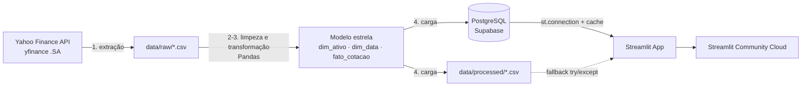

# 📈 Performance de Ações na B3 (2021–2023): Data App de BI Financeiro


> **Projeto Avaliativo Final** · Visualização de Dados e Business Intelligence [T2] · Módulo 2, Semanas 13 e 14
> **Linha 2: Performance de Mercado de Ações & Séries Temporais (B3)**
> Autor: **Jailson Silva** · [LinkedIn](https://www.linkedin.com/in/jailsonsilvaanalista) · [GitHub](https://github.com/JailsonsouzaStarCityCorp)

| Entrega | Link |
|---|---|
| 🚀 App em produção (Streamlit Cloud) | https://projetofinal-3fqbvhzrdk7bgrsk7uhmtn.streamlit.app |
| 🎬 Vídeo pitch (3–5 min) | https://youtu.be/SEU-VIDEO |
| 📋 Quadro Kanban (Trello) | https://trello.com/b/Nd92qOdp/projeto-final-bi-b3-performance-2021-2023 |

---

## 1. Problema de negócio

Um investidor que tivesse distribuído o capital igualmente entre 12 ações líquidas da B3 no primeiro
pregão de 2021 atravessou três anos muito diferentes: a recuperação pós-pandemia, o ciclo de alta da
Selic e o início dos cortes de juros. O app responde, com dados oficiais de cotação, **quanto cada
ativo rendeu, qual risco foi assumido e como cada papel se comportou no caminho**.

### Perguntas de negócio respondidas

| # | Pergunta (enunciado) | Onde no app | Visualização |
|---|---|---|---|
| 1 | Rentabilidade comparativa normalizada (Base 100) de 2021 a 2023 | Aba **Rentabilidade** | Linha Base 100 com referência no nível 100 + ranking |
| 2 | Melhor relação de Sharpe empírica (retorno vs. volatilidade) | Aba **Risco x Retorno** | Dispersão em quadrantes (bolha = volume) + tabela Sharpe |
| 3 | Comportamento estatístico dos retornos diários (dispersão, assimetria, caudas) | Aba **Retornos diários** | Histograma com boxplot marginal + tabela de estatísticas |
| 4 | Drawdown máximo e ativo mais resiliente | Aba **Drawdown** | Área de drawdown + barras do drawdown máximo |
| 5 | Preço vs. médias móveis SMA 21 e SMA 50 | Aba **Médias móveis** | Multilinha com marcação de cruzamentos |
| + | Correlação setorial (contextualização da Linha 2) | Aba **Correlação** | Heatmap de Pearson anotado |

### KPIs (st.metric com deltas)
Retorno médio da carteira · Ativo destaque · Ativo de menor performance · Volatilidade anualizada média ·
Drawdown máximo médio. Os deltas comparam a seleção do usuário com o universo dos 12 ativos no mesmo período.

---

## 2. Arquitetura



### Estrutura de pastas
```
├── app.py                      # Data App Streamlit
├── etl/etl_b3.py               # Pipeline ETL reproduzível
├── src/
│   ├── config.py               # universo de ativos, período, caminhos relativos, cores
│   └── metrics.py              # fórmulas financeiras (compartilhadas por ETL e app)
├── sql/
│   ├── schema.sql              # DDL do esquema estrela (PostgreSQL)
│   └── consultas_analiticas.sql
├── data/
│   ├── raw/                    # dado bruto da API (não versionado, é reproduzível)
│   └── processed/              # CSVs tratados (contingência do app, versionados)
├── docs/                       # relatório do ETL, Kanban, GitFlow, roteiro do vídeo
├── tests/test_metrics.py       # testes das fórmulas
├── .streamlit/config.toml      # tema
├── .streamlit/secrets.toml.example
├── requirements.txt
└── .gitignore                  # inclui .streamlit/secrets.toml
```

---

## 3. Fonte e recorte dos dados

| Item | Descrição |
|---|---|
| Fonte | Histórico diário de cotações da B3 pela API pública do Yahoo Finance (biblioteca `yfinance`, sufixo `.SA`) |
| Período | 01/01/2021 a 31/12/2023 (pregões efetivos) |
| Granularidade | 1 linha por ativo por pregão |
| Universo | 12 ações em 5 setores (tabela abaixo) |
| Obtenção | `python -m etl.etl_b3`, com 1 requisição por ativo e pausa entre elas, respeitando os termos de uso |
| Dados pessoais | Nenhum. Apenas dados públicos de mercado (LGPD não se aplica a pessoas físicas aqui) |

| Setor (classificação B3, agrupada) | Ativos |
|---|---|
| Bens Industriais | WEGE3 (WEG), EMBR3 (Embraer) |
| Materiais Básicos | VALE3 (Vale), GGBR4 (Gerdau), KLBN11 (Klabin) |
| Petróleo e Energia | PETR4 (Petrobras), PRIO3 (PRIO), EGIE3 (Engie Brasil) |
| Financeiro | ITUB4 (Itaú Unibanco), BBDC4 (Bradesco) |
| Consumo | ABEV3 (Ambev), RENT3 (Localiza) |

> A Embraer passou a negociar como **EMBJ3**. O ETL tenta `EMBR3.SA` e, se vier vazio, usa `EMBJ3.SA`.
> O símbolo efetivamente usado fica registrado na coluna `ticker_yahoo`.

---

## 4. Pipeline ETL (`etl/etl_b3.py`)

1. **Extração:** `yf.Ticker(simbolo).history(auto_adjust=False)` por ativo. O bruto é salvo em `data/raw/` para auditoria.
2. **Limpeza:**
   - **Datas:** a string com fuso (`2021-01-04 00:00:00-03:00`) é convertida em `datetime64` sem fuso.
   - **Valores monetários:** coerção para `float` (vírgula decimal convertida em ponto).
   - **Duplicados:** remoção por (`ticker`, `data`).
   - **Nulos:** linhas sem fechamento ajustado são removidas; outros preços faltantes recebem *forward fill* dentro do mesmo ativo; volume nulo vira 0.
   - **Inconsistências:** remoção de preços ≤ 0 e de linhas com máxima < mínima; pregões com volume zero ficam sinalizados (`sem_negocio`).
   - **Encoding:** leitura e escrita explícitas em UTF-8.
3. **Transformação:** volume financeiro, retorno diário, Base 100, pico, drawdown, SMA 21 e SMA 50.
4. **Modelagem dimensional:** esquema estrela `dim_ativo` (1) ─ (N) `fato_cotacao` (N) ─ (1) `dim_data`.
5. **Carga:** CSVs em `data/processed/` e, com `--postgres`, tabelas no Supabase (`sql/schema.sql`).

O resumo de cada execução (contagens de nulos, duplicados e linhas) é salvo em `docs/relatorio_etl.txt`.

---

## 5. Dicionário de dados

### `fato_cotacao` (grão: ativo × pregão)
| Campo | Tipo | Descrição financeira | Regra de cálculo |
|---|---|---|---|
| `id_ativo` | int (FK) | Chave do ativo | `dim_ativo.id_ativo` |
| `data` | date (FK) | Data do pregão | Convertida de string com fuso para `datetime` |
| `abertura` | float | Preço de abertura (R$, não ajustado) | Fonte |
| `maxima` | float | Maior preço do dia (R$) | Fonte; validado `maxima ≥ minima` |
| `minima` | float | Menor preço do dia (R$) | Fonte |
| `fechamento` | float | Preço de fechamento nominal (R$) | Fonte |
| `fechamento_ajustado` | float | Fechamento ajustado por proventos e desdobramentos (R$) | Fonte (*Adj Close*); base de todos os retornos |
| `volume` | int | Quantidade de ações negociadas | Fonte; nulo → 0 |
| `volume_financeiro` | float | Valor negociado no dia (R$) | `volume × fechamento` |
| `retorno_diario` | float | Variação percentual diária (fração) | `P_t / P_{t-1} − 1` |
| `base100` | float | Valor de R$ 100 aplicados no início | `100 × P_t / P_0` |
| `drawdown` | float | Queda desde o maior preço anterior (fração ≤ 0) | `P_t / max(P_0..P_t) − 1` |
| `sma_21` | float | Média móvel simples de 21 pregões (R$) | `rolling(21).mean()` |
| `sma_50` | float | Média móvel simples de 50 pregões (R$) | `rolling(50).mean()` |
| `sem_negocio` | bool | Pregão sem negócios | `volume == 0` |

### `dim_ativo`
| Campo | Tipo | Descrição |
|---|---|---|
| `id_ativo` | int (PK) | Chave substituta |
| `ticker` | text | Código de negociação na B3 |
| `ticker_yahoo` | text | Símbolo consultado na API |
| `empresa` | text | Nome da companhia |
| `setor` | text | Setor econômico (classificação B3 agrupada) |

### `dim_data`
| Campo | Tipo | Descrição |
|---|---|---|
| `data` | date (PK) | Pregão |
| `ano`, `trimestre`, `mes` | int | Atributos de calendário |
| `dia_semana` | int | 1 = segunda … 5 = sexta |

### Métricas calculadas no app (`resumo_ativos.csv` / aba Dados)
| Métrica | Regra |
|---|---|
| Retorno acumulado | `P_fim / P_início − 1` na janela filtrada |
| Retorno anualizado | `(1 + R_acum)^(252/n) − 1` |
| Volatilidade anualizada | `desvio-padrão(r_t) × √252` |
| Sharpe | `(R_anual − r_f) / σ_anual`. Com `r_f = 0` é o Sharpe empírico; o usuário pode informar o CDI |
| Drawdown máximo | menor valor de `drawdown` na janela |
| Assimetria / curtose | `skew()` / `kurt()` (excesso) dos retornos diários |
| VaR 95% histórico | 5º percentil dos retornos diários |

> Base 100 e drawdown são **recalculados a cada filtro de período**, de modo que o ponto de partida
> e o pico considerado sejam sempre os da janela escolhida. As SMAs são calculadas na série completa
> para não perder os pregões de aquecimento.

---

## 6. Requisitos técnicos atendidos

| Requisito | Implementação |
|---|---|
| Conexão resiliente | `st.connection("postgresql", type="sql")` em `try/except`, com fallback para `data/processed/*.csv`. A fonte ativa aparece na barra lateral |
| Segurança de credenciais | `.streamlit/secrets.toml` no `.gitignore`; modelo em `secrets.toml.example` |
| Cache | `@st.cache_data(ttl=3600)` na carga, no recorte por janela e no resumo |
| Estado e reatividade | Filtros cruzados de setor → ativos, período (slider + atalhos por ano) e taxa livre de risco, todos em `st.session_state`, com botão **Resetar filtros** |
| KPIs | 5 cartões `st.metric` com deltas em `st.columns` |
| Abas | 8 abas temáticas `st.tabs` |
| Exportação | `st.download_button` da base filtrada e do resumo (CSV `;` com vírgula decimal, compatível com o Excel em português) |
| Visualizações | 8 gráficos Plotly Express de 6 tipos: linha, barras, dispersão, histograma com boxplot, área e heatmap |
| Caminhos relativos | `pathlib` a partir da raiz do repositório (`src/config.py`); nenhum caminho absoluto |
| UX/UI | Pirâmide invertida (contexto → gráfico → insight → ação) em cada aba; cores fixas por setor; formato numérico brasileiro; rótulos diretos nas linhas |

---

## 7. Como executar

```bash
git clone https://github.com/JailsonsouzaStarCityCorp/Projetofinal.git
cd Projetofinal
python -m venv .venv && source .venv/bin/activate      # Windows: .venv\Scripts\activate
pip install -r requirements.txt

python -m etl.etl_b3            # baixa as cotações e gera data/processed/
python -m pytest                # testes das fórmulas
streamlit run app.py
```

### Banco na nuvem (opcional, recomendado)
1. Crie um projeto no [Supabase](https://supabase.com) e copie a *connection string* (Project Settings → Database).
2. `cp .streamlit/secrets.toml.example .streamlit/secrets.toml` e preencha.
3. `python -m etl.etl_b3 --offline --postgres` cria as tabelas (`sql/schema.sql`) e carrega os dados.

### Deploy no Streamlit Community Cloud
1. Faça push da branch `main` com os CSVs de `data/processed/`.
2. Em [share.streamlit.io](https://share.streamlit.io): **New app** → repositório → branch `main` → `app.py`.
3. Em **Advanced settings → Secrets**, cole o conteúdo do seu `secrets.toml`. Sem secrets, o app roda pelo CSV de contingência.

---

## 8. Principais achados

*Janela completa: 04/01/2021 a 28/12/2023 (745 pregões). Valores arredondados; os números exatos são recalculados no app conforme os filtros.*

- **Rentabilidade (Base 100):** a carteira de pesos iguais teria rendido cerca de **+58%**, mas o ganho foi concentrado. **PETR4 (+229%)**, **PRIO3 (+208%)** e **EMBR3 (+168%)** responderam pela maior parte do resultado. A mediana dos 12 ativos foi de apenas **+21%**, e **BBDC4 (−7%)**, **KLBN11 (−1%)** e **RENT3 (0%)** terminaram no zero a zero ou abaixo.
- **Setores:** Petróleo e Energia liderou (média de +154%), seguido de Bens Industriais (+86%). Materiais Básicos (+16%), Financeiro (+9%) e Consumo (+1%) ficaram bem atrás.
- **Risco x retorno:** pelo Sharpe empírico (retorno anualizado ÷ volatilidade), **PETR4** teve a melhor relação (≈ 1,3), seguida de PRIO3 e EMBR3. EMBR3 e PRIO3 também foram os papéis mais voláteis (≈ 47% a.a.).
- **Resiliência (drawdown):** **EGIE3** foi o ativo mais defensivo, com a menor volatilidade (≈ 19% a.a.) e a menor queda a partir do topo (−18%). As quedas mais profundas foram de **EMBR3 (−58%)**, **WEGE3 (−50%)** e **BBDC4 (−46%)**.
- **Leitura executiva:** retornos elevados vieram acompanhados de alta volatilidade e quedas intermediárias relevantes; a seleção de ativos pesou mais que a média da carteira. Estes são resultados descritivos do período e não indicam causa nem desempenho futuro.

### Limitações e rigor metodológico
- Análise **descritiva** de um recorte histórico de 3 anos; os resultados não se generalizam para outros períodos.
- Correlação **não implica causalidade**. Nenhuma relação causal é afirmada e nenhum modelo econométrico foi estimado.
- O ajuste de proventos do Yahoo Finance segue a metodologia do provedor e pode divergir um pouco da B3.
- A carteira simulada é de pesos iguais, sem rebalanceamento, custos ou impostos.
- **Não é recomendação de investimento.**

---

## 9. Gestão do projeto
- **Kanban (Trello):** [link do quadro](https://trello.com/b/Nd92qOdp/projeto-final-bi-b3-performance-2021-2023). Cartões em `docs/kanban_trello.md`.
- **GitFlow:** `main` (produção) ← `develop` ← `feature/*`, com commits semânticos. Passo a passo em `docs/gitflow.md`.

## 10. Referências
- Yahoo Finance via [yfinance](https://github.com/ranaroussi/yfinance), cotações históricas da B3
- [B3, Classificação setorial](https://www.b3.com.br/pt_br/produtos-e-servicos/negociacao/renda-variavel/acoes/consultas/classificacao-setorial/)
- [Documentação Streamlit](https://docs.streamlit.io), em especial `st.connection`, `st.cache_data` e `st.session_state`
- [Plotly Express](https://plotly.com/python/plotly-express/)
- [Supabase](https://supabase.com/docs)
- SHARPE, W. F. *The Sharpe Ratio*. Journal of Portfolio Management, 1994.
- NIELSEN, J. *10 Usability Heuristics for User Interface Design*. Nielsen Norman Group.
- **Uso de IA generativa:** este projeto contou com apoio do assistente Claude (Anthropic) na estruturação do código, do pipeline ETL e da documentação. A execução do ETL, a validação dos dados, o versionamento, o deploy e a análise dos resultados foram realizados pelo autor.

---
*Projeto acadêmico, SENAI/SC. Dados públicos de mercado.*
